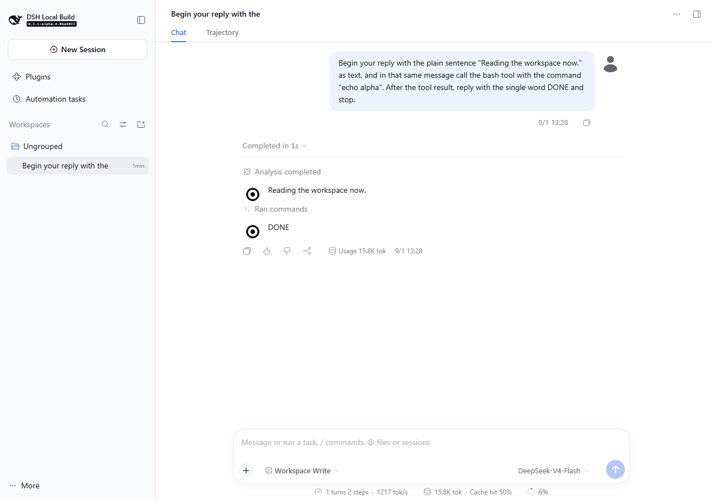
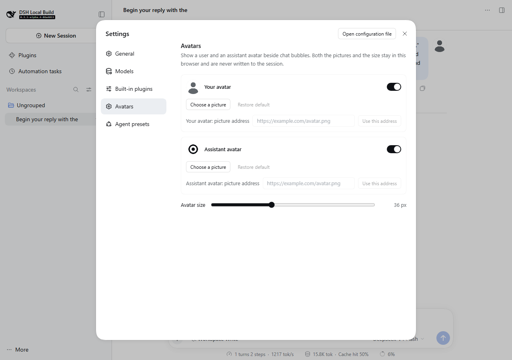

English | [中文](README.zh.md)

# dsh-avatar-chat

Dual avatars for the DeepSeek Harness chat transcript — a user avatar on the right of every user turn, an assistant avatar on the left of every answer — plus an **Avatars** page in Settings to switch each side on or off, set a picture, and pick the size.

A DSH Web Client plugin: a Cordis bundle that registers one `settings.section` seat and decorates the transcript with a page-level stylesheet.

## Screenshots

Transcript — the user avatar on the right and the assistant avatar on the left, at 36 px with no picture set:



Settings — the **Avatars** page this plugin adds:



Both were captured from a synthetic recorded session that ships with the DeepSeek Harness test suite, not from anyone's real conversation.

## Features

- **Two independent avatars.** The user side and the assistant side each have their own visibility toggle, their own picture, and their own restore-to-default.
- **Pictures from disk or from a URL.** Upload PNG / JPEG / WebP / GIF (max 5 MiB, downscaled to 256 px), or paste an `https://…` address. The address is probed once before it is adopted.
- **Built-in look with no picture at all.** With no upload, each side draws a pure-CSS disc using theme tokens only — no bundled image, no literal colour, correct in light and dark.
- **Size from 20 px to 64 px**, applied live to both the transcript and the settings preview.
- **Undecorated where it should be.** One assistant reply is split into a reasoning row and a response row; only the answer row carries an avatar, so a reply never shows two.
- **Clean unload.** Every root attribute and custom property the plugin writes is removed when the plugin is disposed.

## Requirements

- DeepSeek Harness `0.2.1-alpha.4` (Web / Desktop). The plugin uses only the shipped theme tokens and the `settings.section` slot.
- The four modules the bundle requires at runtime — `react`, `react/jsx-runtime`, `@deepseek-ai/dsh-client-store`, `@deepseek-ai/dsh-client-ui-primitives` — are all part of the shell's frozen module table, so nothing extra needs installing next to this package.

## Install

A profile-local plugin joins a profile as a **bundle**. The profile's own `cordis.patch.yml` is *id-targeted* — it can only override or disable entries that a bundle layer already declared — so adding a row there does nothing.

### Manual install (verified)

Works for the desktop app, whose profile is managed exclusively by the application and therefore cannot be edited through the `dsh` CLI.

1. Copy this repository into the profile's `node_modules` under the package name:

   ```
   <profile>/node_modules/dsh-avatar-chat/
   ```

   `<profile>` is e.g. `~/.dsh/profiles/desktop`. Ship `package.json`, `cordis.patch.yml` and `lib/`.

2. Add the package name to the profile's `package.json` under `dsh.profile.bundles`:

   ```json
   "dsh": {
     "profile": {
       "bundles": [
         "…",
         "dsh-avatar-chat"
       ]
     }
   }
   ```

   Being listed here is what composes the plugin into the tree; it does not also have to appear in `dependencies`.

3. Restart the application. The bundle stack is recomposed at boot.

### Other profiles

For a profile the `dsh` CLI is allowed to manage:

```sh
dsh plugin --profile <profile> add link:<absolute path to this repository>
```

### Verify

After the restart, this should name the package and a real directory:

```
cordis_inspect → host / Config / listConfigs { "entry": "include:ui-avatar-chat" }
```

## Usage

Open **Settings → Avatars**.

- **User avatar** / **Assistant avatar** — the switch hides that side from the transcript; the picture button opens a file picker; **Restore default** returns the side to the built-in disc.
- **Picture address** — paste an `https://…` URL and apply it.
- **Avatar size** — 20 px to 64 px. Changes apply immediately.

Nothing else to do: the transcript picks the settings up on the next paint.

## Storage and privacy

Preferences live in the browser's `localStorage` under the single key `dsh.avatar-chat.v1`, as JSON:

```json
{ "schemaVersion": 1, "size": 28,
  "user":      { "visible": true, "image": "data:image/webp;base64,…" },
  "assistant": { "visible": true, "image": null } }
```

- Uploaded pictures are stored as **data URLs** — they never leave the browser, and they are never written into the session log.
- The value is **plain text in origin-shared storage**: any script on the same origin can read it. Do not upload anything you would not put in a local file.
- Reads and writes are individually guarded. A denied origin, an exhausted quota, or a damaged value degrades to in-memory preferences plus an on-page notice instead of breaking the plugin load.
- A document with a foreign `schemaVersion`, an out-of-range size, or a malformed side is repaired in place and reported as damaged.

## How it works

DSH has no slot that adds leading or trailing chrome to an individual chat message row: `conversation.chat.node`'s keyed seats are already fully occupied by the shipped renderers (`user`, `steering`, `assistant-step`, …) and a third-party package cannot import or wrap them. Every class name inside the chat subtree is also a CSS-Modules hash, so it is not addressable from another package.

What *is* stable is the row element itself, which carries `data-chat-flow-kind` (equal to the chat node kind), `data-chat-turn`, and `data-chat-group-part`. So the plugin ships a page-level stylesheet that selects on those attributes, and drives it entirely from root-element state:

- attributes `data-dsh-avatar-chat`, `-user`, `-user-image`, `-assistant`, `-assistant-image`
- custom properties `--dsh-avatar-chat-size` and the two picture variables

The avatar is painted by an absolutely-positioned `::before` inside padding the stylesheet reserves on the decorated row; the row keeps its shipped `display`, so host layout is untouched.

The stylesheet is a plain `.css` side-effect import, which the DSH client bundler turns into a tagged `<style data-plugin-css>` element — deduplicated by tag id, so re-running the plugin never double-injects it. Every root write is absolute, so applying twice is idempotent.

## Known limitations

- The decoration depends on `data-chat-flow-kind`, which is **not a published contract**. If the chat row markup changes, avatars disappear silently until the selector is updated.
- Only `user`, `steering` and `assistant-step` rows are decorated. Tool calls, commands, system prompts and turn-process rows have no avatar.
- A decorated row becomes `position: relative`, so it is the containing block for its own absolutely-positioned descendants.
- The avatar carries no per-message identity — there is exactly one user picture and one assistant picture at a time.
- A remote picture address is probed once when it is applied and is not revalidated afterwards.
- The built-in disc uses `--dsw-alias-brand-primary`, which is near-black in light mode and near-white in dark mode — an inverse monochrome accent, not a brand blue.

## Compatibility

Verified against DeepSeek Harness `0.2.1-alpha.4` on Windows with the shipped Web client, in both unit tests and a real headless-Chromium run against an assembled profile.

## Building from source

The `lib/` directory in this repository is the built artifact and is what the loader consumes. Rebuilding it requires a DeepSeek Harness source checkout: this package is compiled by the repository's shared client bundler preset (`packages/client/tsdown.client.ts`), which owns the `window.__ModuleLoader__.load({ id, factory })` wrapper, the platform externals, and the CSS inlining.

To rebuild: place `src/` at `packages/client/ui-avatar-chat/src` in the checkout, then

```sh
pnpm --filter @deepseek-ai/dsh-client-ui-avatar-chat bundle
```

Keep the package name in sync — the module id baked into `lib/client.js` comes from `package.json`, and the loader matches the bundle row to that id.

## License

MIT
